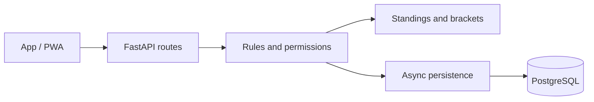
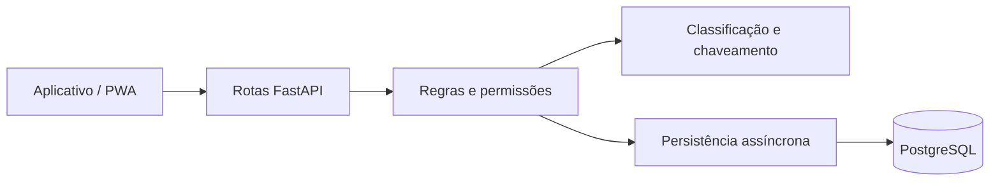

# Fut Manager · API

[English](#english) · [Português (Brasil)](#portugues-brasil)

<a id="english"></a>

## English

[English](#english) · [Português (Brasil)](#portugues-brasil)

Fut Manager is a personal project for organizing amateur football, from confirming attendance at a pickup game to winning a tournament. The API manages competition rules, results, and the history of players and teams.

The project grew out of a practical need to organize matches and has already been tested in a real tournament. It is evolving toward an MVP, with improvements guided by its use on the pitch.

### Engineering decisions and code to explore

Developed by **[Pedro Vieira](https://github.com/pedro-vlps)** as an end-to-end portfolio project: domain modeling, API contracts, persistence, security, regression testing, and deployment. The implementation demonstrates backend engineering through concrete business constraints:

| Challenge | Implementation | Code / evidence |
| --- | --- | --- |
| Keep HTTP and persistence concerns separate | Routes delegate to controllers; SQL queries stay in services, with automated architecture checks | [Routes](src/routers), [services](src/services), [architecture tests](tests/test_architecture.py) |
| Preserve consistency under concurrent writes | Database row locks serialize changes to an edition or event inside transactions | [Competition services](src/services/championships.py), [event write guard](src/services/event_write_guard.py), [permission rechecks](tests/test_group_roles.py) |
| Evolve complex competition rules | Standings, fixture generation, walkovers, disqualifications, and awards have explicit domain helpers and regression cases | [Domain helpers](src/helpers), [championship tests](tests/test_championships.py), [award tests](tests/test_trophies.py) |
| Protect personal data while supporting lookup | Authenticated encryption for stored personal fields, a separate HMAC email index, and salted scrypt password hashes | [Privacy helpers](src/helpers/privacy.py), [authentication](src/controllers/auth.py), [password tests](tests/test_password_policy.py) |
| Test real persistence behavior | Asynchronous HTTP integration tests use PostgreSQL and transaction rollback; the isolated runner creates a fresh schema and ephemeral encryption keys | [Authentication tests](tests/test_auth.py), [isolated runner](scripts/run_feedback_tests.py) |

The API also uses my **[api_crud_generate_libary](https://github.com/pedro-vlps/api_crud_generate_libary)** dependency for shared CRUD infrastructure. Project-specific permissions and competition rules remain in this repository.

**Current tradeoffs:** this is an MVP under active development. Authentication sessions are held in process memory, so restarts invalidate sessions and multiple workers would need a shared session store. Versioned migration scripts require explicit ordering; schema creation at startup is intended for new installations. These are concrete next steps for operating at a larger scale.

### Features

- **Pickup football groups:** invitations, join requests approved by administrators, members, and guest players.
- **Event management:** scheduling, weekly recurrence, attendance confirmation, and waiting lists, with separate places for outfield players and goalkeepers.
- **Team selection:** draws that consider preferred positions, ratings, and performance to balance squads.
- **Matches and match reports:** goals, assists, own goals, cards, goalkeepers, substitutions, and a match timer.
- **Tournaments:** leagues, group stages followed by knockout rounds, single elimination, and Cascade brackets with winners' and losers' paths.
- **Competition rules:** random group draws, 3–0 walkover wins, points deductions, and disqualification while keeping the bracket moving.
- **Rankings and achievements:** statistics, seasons, individual awards, and team trophy rooms.
- **Following tournaments:** a feed where authenticated users can browse tournaments, matches, results, and rankings without entering the competition.

### Rules that matter

Leagues support any number of teams starting from two, including odd numbers. Fixtures use the teams registered when the competition starts, with either a single round robin or home-and-away matches and byes when needed.

A walkover awards a 3–0 win to the team that attends. The result counts toward the standings and goal difference, without creating goals, assists, or artificial performance statistics for players. In knockout stages, the winner advances.

Penalties are recorded for each tournament edition. A points deduction keeps the team in the competition; disqualification removes its qualifying places and turns its future matches into walkovers. Completed results are preserved.

Teams can predefine their starting goalkeeper, which is automatically assigned to tournament fixtures. Organizers record in-match substitutions, and each conceded goal stays with the goalkeeper who was in goal for that event.

Each individual award has one winner. The category ranking determines the leader, and team placement breaks ties, with the champion ahead of the runner-up. The best goalkeeper award follows the ranking for fewest goals conceded among players who actually played in goal.

### Technology and architecture

**Python 3.13 · FastAPI · Pydantic · Async SQLAlchemy · PostgreSQL · Poetry · Docker**



Routes delegate operations to controllers, while services handle database access. Helpers implement standings, fixture generation, and award rules. Typed schemas define the contract with the app, and versioned migrations support database evolution.

Result, registration, and penalty operations lock the tournament edition during the transaction to keep concurrent requests consistent.

### Data protection

Names, email addresses, personal avatar URLs, guest names, and copies of names in match reports and historical records are encrypted at rest using authenticated encryption. An HMAC index supports email lookup without storing the email text in the index. Passwords use scrypt with random salts, stronger parameters for new hashes, and compatibility with older hashes.

New passwords require at least eight characters, an uppercase letter, a lowercase letter, a number, and a special character.

Keys remain in the private environment, outside Git. Invitation codes are visible only to administrators and can be regenerated. The API disables public profile CRUD; account registration and access to a user's own account go through authentication routes.

### Run locally

1. Install Python 3.13+, Poetry, and PostgreSQL, or use Docker.
2. Run `poetry install`.
3. Configure the variables from `.env.example` in a private `.env`, including encryption keys. Generate a Fernet key with `Fernet.generate_key()`; the HMAC key must be an independent random secret.
4. For a new installation, set `FUT_MANAGER_CREATE_SCHEMA_ON_STARTUP=true`. For an existing database, follow **the migration order in [Feedback.md](Feedback.md) (Portuguese)** before starting this version.
5. Run:

```powershell
poetry run python -m uvicorn src.__main__:app --reload
```

Interactive API documentation is available at `/docs` when `FUT_MANAGER_DOCS_ENABLED=true`. Keep real credentials and keys out of version-controlled files.

### Validation

Tests cover authentication, permissions, attendance confirmation, calendars, standings, brackets, and awards. The feedback suite adds walkovers, simultaneous disqualifications, odd-sized leagues, invitation code regeneration, and encrypted persistence.

```powershell
poetry run python -m unittest discover -s tests -v
```

With an isolated PostgreSQL instance already running on port 55439, use `poetry run python -m scripts.run_feedback_tests`. This command is intended exclusively for the isolated test database.

### Continuous integration and Railway

Both repositories are deployed on Railway, with automatic redeployment from `main`. GitHub Actions runs on **every push and pull request**, and can also be started manually.

The [API tests workflow](.github/workflows/tests.yml) installs locked dependencies with Python 3.13 and Poetry 2.3.3, starts disposable PostgreSQL 17 on port 55439, and runs the entire unittest suite through the isolated runner. It never connects to the deployed database or uses production keys.

The existing private-configuration and secret-history checks also remain enabled.

**Required Railway setting:** workflows alone do not block the existing automatic deployment. In **each service**, open **Settings → Source → Wait for CI** and enable it, keeping `main` as the deployment branch. After publishing the workflow, accept any pending Railway GitHub App permission update if the option is unavailable. This is a service setting, not a `railway.json` property.

With **Wait for CI enabled**, Railway waits for the commit's GitHub Actions workflows; a failed workflow skips that deployment. Push runs are not automatically cancelled by these workflows. Confirm the integration on the next `main` push: the deployment should wait for CI, proceed after successful checks, and be skipped when a workflow fails. **Until that setting is enabled, automatic deployment is not protected by these tests.** See [Railway's autodeploy documentation](https://docs.railway.com/deployments/github-autodeploys).

### More about the project

The companion app is in the **[fut_manager_app_mobile](https://github.com/pedro-vlps/fut_manager_app_mobile)** repository and uses Expo, React Native, and TypeScript, with web/PWA distribution and support for native builds.

- [Changes following tournament testing (Portuguese)](Feedback.md)
- [Previous technical documentation (Portuguese)](docs/DEVELOPMENT.md)

Developed by **Pedro Vieira** as a personal portfolio project.

---

<a id="portugues-brasil"></a>

## Português (Brasil)

[English](#english) · [Português (Brasil)](#portugues-brasil)

Fut Manager é um projeto pessoal para organizar o futebol amador: da confirmação de presença na pelada ao título de um campeonato. A API concentra as regras da competição, os resultados e o histórico dos jogadores e times.

O projeto nasceu de uma necessidade prática de organizar jogos e já passou por testes em um campeonato real. Está em evolução rumo ao MVP, com ajustes orientados pelo uso em campo.

### Decisões de engenharia e código para explorar

Desenvolvido por **[Pedro Vieira](https://github.com/pedro-vlps)** como projeto de portfólio de ponta a ponta: modelagem do domínio, contratos da API, persistência, segurança, testes de regressão e deploy. A implementação demonstra desenvolvimento backend a partir de problemas concretos:

| Desafio | Implementação | Código / evidência |
| --- | --- | --- |
| Separar HTTP e persistência | Rotas delegam aos controllers; consultas SQL ficam nos services, com testes que verificam os limites da arquitetura | [Rotas](src/routers), [services](src/services), [testes de arquitetura](tests/test_architecture.py) |
| Manter consistência em escritas concorrentes | Bloqueios de linha no banco serializam alterações de uma edição ou evento dentro da transação | [Services de campeonatos](src/services/championships.py), [proteção de eventos](src/services/event_write_guard.py), [rechecagem de permissões](tests/test_group_roles.py) |
| Evoluir regras complexas de competição | Classificação, calendário, WO, punições e premiações têm helpers de domínio e casos de regressão explícitos | [Helpers de domínio](src/helpers), [testes de campeonatos](tests/test_championships.py), [testes de premiações](tests/test_trophies.py) |
| Proteger dados pessoais e permitir buscas | Criptografia autenticada nos campos pessoais, índice HMAC independente para e-mail e hashes scrypt com salt | [Helpers de privacidade](src/helpers/privacy.py), [autenticação](src/controllers/auth.py), [testes de senhas](tests/test_password_policy.py) |
| Testar persistência real | Testes HTTP assíncronos usam PostgreSQL e rollback; o runner isolado cria o schema e chaves efêmeras | [Testes de autenticação](tests/test_auth.py), [runner isolado](scripts/run_feedback_tests.py) |

A API também utiliza minha biblioteca **[api_crud_generate_libary](https://github.com/pedro-vlps/api_crud_generate_libary)** para infraestrutura compartilhada de CRUD. Permissões específicas e regras de competição ficam neste repositório.

**Limites atuais:** o MVP está em desenvolvimento. As sessões de autenticação ficam em memória no processo; reinícios invalidam sessões e múltiplos workers exigiriam armazenamento compartilhado. Scripts de migração versionados precisam ser executados em ordem explícita; a criação de schema no startup atende instalações novas. São próximos passos concretos para operar em maior escala.

### O que o projeto oferece

- **Grupos de pelada:** convites, pedidos de entrada aprovados por administradores, membros e convidados.
- **Organização dos eventos:** agenda, recorrência semanal, confirmação de presença e lista de espera, com vagas para jogadores e goleiros.
- **Montagem de times:** sorteio com preferências de posição, avaliações e desempenho para equilibrar os elencos.
- **Partidas e súmulas:** gols, assistências, gols contra, cartões, goleiros, substituições e cronômetro.
- **Campeonatos:** liga, grupos com mata-mata, eliminação simples e cascata com chaves de vencedores e perdedores.
- **Regulamento em ação:** sorteio dos grupos, WO de 3 a 0, perda de pontos e desclassificação com continuidade do chaveamento.
- **Rankings e conquistas:** estatísticas, temporadas, premiações individuais e sala de troféus dos times.
- **Acompanhamento:** feed para consultar campeonatos, jogos, resultados e rankings mesmo sem participar da edição, com uma conta autenticada.

### Regras que fazem a diferença

A liga aceita qualquer quantidade de times a partir de dois, inclusive quantidades ímpares. O calendário usa os inscritos no momento do início, em turno único ou ida e volta, com folgas quando necessário.

WO vale 3 a 0 para o time presente. O placar entra na classificação e no saldo de gols, sem gerar gols, assistências ou desempenho artificial para os jogadores. Em fases eliminatórias, o vencedor avança.

As punições ficam registradas por edição. Perda de pontos mantém o time na disputa; a desclassificação retira suas vagas de avanço e transforma seus jogos futuros em WO. Resultados já disputados são preservados.

Os times podem predefinir seu goleiro titular, preenchido automaticamente nos jogos. O organizador registra as substituições durante a partida, e cada gol sofrido permanece com quem estava no gol naquele lance.

Cada premiação individual tem um vencedor. O ranking da categoria define a liderança; a colocação do time resolve os empates, com o campeão à frente do vice. O melhor goleiro segue o ranking de menos gols sofridos entre os jogadores que atuaram no gol.

### Tecnologia e arquitetura

**Python 3.13 · FastAPI · Pydantic · SQLAlchemy assíncrono · PostgreSQL · Poetry · Docker**



As rotas delegam as operações aos controllers; os services concentram o acesso ao banco. Helpers implementam regras de classificação, calendário e premiação. Schemas tipados definem o contrato com o aplicativo e migrations versionadas permitem evoluir o banco.

As operações de resultados, inscrições e punições bloqueiam a edição durante a transação para manter o campeonato consistente em requisições concorrentes.

### Proteção de dados

Nomes, e-mails, URLs pessoais de avatar, nomes de convidados e cópias de nomes nas súmulas e históricos são cifrados em repouso com criptografia autenticada. Um índice HMAC permite localizar e-mails sem guardar seu texto no índice. Senhas usam scrypt com salt aleatório, com parâmetros fortalecidos para novos hashes e compatibilidade com os anteriores.

Novas senhas exigem pelo menos oito caracteres, uma maiúscula, uma minúscula, um número e um caractere especial.

Chaves ficam no ambiente privado, fora do Git. Códigos de convite são visíveis apenas para administradores e podem ser renovados. A API desativa o CRUD público de perfis; cadastro e consulta da própria conta passam pelas rotas de autenticação.

### Executar localmente

1. Instale Python 3.13+, Poetry e PostgreSQL, ou utilize Docker.
2. Execute `poetry install`.
3. Configure as variáveis de `.env.example` em um `.env` privado, incluindo as chaves de criptografia. A chave Fernet é gerada com `Fernet.generate_key()`; a chave de HMAC deve ser um segredo aleatório independente.
4. Para uma instalação nova, ative `FUT_MANAGER_CREATE_SCHEMA_ON_STARTUP=true`. Para bancos existentes, siga **a ordem de migração em [Feedback.md](Feedback.md)** antes de iniciar esta versão.
5. Execute:

```powershell
poetry run python -m uvicorn src.__main__:app --reload
```

A documentação interativa fica em `/docs` quando `FUT_MANAGER_DOCS_ENABLED=true`. Não configure credenciais ou chaves reais em arquivos versionados.

### Validação

Os testes cobrem autenticação, permissões, confirmação de presença, calendários, classificações, chaveamento e premiações. A suite de feedback acrescenta WO, punições simultâneas, ligas ímpares, renovação de convites e persistência cifrada.

```powershell
poetry run python -m unittest discover -s tests -v
```

Com uma instância isolada de PostgreSQL já disponível na porta 55439, use `poetry run python -m scripts.run_feedback_tests`. Esse comando é destinado exclusivamente ao banco de teste isolado.

### Integração contínua e Railway

Os dois repositórios estão publicados no Railway, com redeploy automático pela `main`. O GitHub Actions executa em **todo push e pull request**, além de permitir execução manual.

O [workflow de testes da API](.github/workflows/tests.yml) instala as dependências do lockfile com Python 3.13 e Poetry 2.3.3, inicia PostgreSQL 17 descartável na porta 55439 e executa toda a suite unittest pelo runner isolado. Não conecta ao banco publicado nem utiliza chaves de produção.

As verificações existentes de configuração privada e segredos no histórico continuam habilitadas.

**Configuração obrigatória no Railway:** os workflows sozinhos não bloqueiam o deploy automático existente. Em **cada serviço**, abra **Settings → Source → Wait for CI** e ative a opção, mantendo `main` como branch de deploy. Depois de publicar o workflow, aceite uma eventual atualização de permissões do Railway GitHub App caso a opção não apareça. É uma configuração do serviço, não uma propriedade do `railway.json`.

Com **Wait for CI ativado**, o Railway aguarda os workflows do commit; se um workflow falhar, aquele deploy é ignorado. Estes workflows não cancelam automaticamente execuções de push. Confira a integração no próximo push da `main`: o deploy deve aguardar o CI, prosseguir após sucesso e ser ignorado quando um workflow falhar. **Até ativar essa opção, o deploy automático não estará protegido por estes testes.** Consulte a [documentação de autodeploy do Railway](https://docs.railway.com/deployments/github-autodeploys).

### Mais sobre o projeto

O aplicativo complementar está no repositório **[fut_manager_app_mobile](https://github.com/pedro-vlps/fut_manager_app_mobile)** e utiliza Expo, React Native e TypeScript, com distribuição web/PWA e suporte a builds nativos.

- [Mudanças após os testes do campeonato](Feedback.md)
- [Documentação técnica anterior](docs/DEVELOPMENT.md)

Desenvolvido por **Pedro Vieira**, como projeto pessoal de portfólio.
