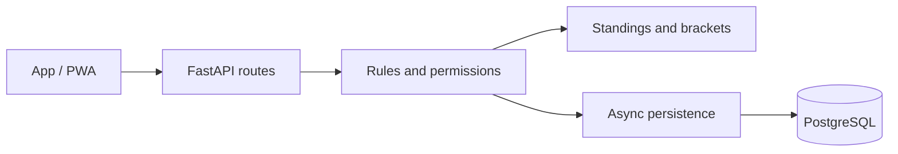

# Fut Manager · API

**English** | [Português (Brasil)](README.pt-BR.md)

Fut Manager is a personal project for organizing amateur football, from confirming attendance at a pickup game to winning a tournament. The API manages competition rules, results, and the history of players and teams.

The project grew out of a practical need to organize matches and has already been tested in a real tournament. It is evolving toward an MVP, with improvements guided by its use on the pitch.

## Features

- **Pickup football groups:** invitations, join requests approved by administrators, members, and guest players.
- **Event management:** scheduling, weekly recurrence, attendance confirmation, and waiting lists, with separate places for outfield players and goalkeepers.
- **Team selection:** draws that consider preferred positions, ratings, and performance to balance squads.
- **Matches and match reports:** goals, assists, own goals, cards, goalkeepers, substitutions, and a match timer.
- **Tournaments:** leagues, group stages followed by knockout rounds, single elimination, and Cascade brackets with winners' and losers' paths.
- **Competition rules:** random group draws, 3–0 walkover wins, points deductions, and disqualification while keeping the bracket moving.
- **Rankings and achievements:** statistics, seasons, individual awards, and team trophy rooms.
- **Following tournaments:** a feed where authenticated users can browse tournaments, matches, results, and rankings without entering the competition.

## Rules that matter

Leagues support any number of teams starting from two, including odd numbers. Fixtures use the teams registered when the competition starts, with either a single round robin or home-and-away matches and byes when needed.

A walkover awards a 3–0 win to the team that attends. The result counts toward the standings and goal difference, without creating goals, assists, or artificial performance statistics for players. In knockout stages, the winner advances.

Penalties are recorded for each tournament edition. A points deduction keeps the team in the competition; disqualification removes its qualifying places and turns its future matches into walkovers. Completed results are preserved.

Teams can predefine their starting goalkeeper, which is automatically assigned to tournament fixtures. Organizers record in-match substitutions, and each conceded goal stays with the goalkeeper who was in goal for that event.

Each individual award has one winner. The category ranking determines the leader, and team placement breaks ties, with the champion ahead of the runner-up. The best goalkeeper award follows the ranking for fewest goals conceded among players who actually played in goal.

## Technology and architecture

**Python 3.13 · FastAPI · Pydantic · Async SQLAlchemy · PostgreSQL · Poetry · Docker**



Routes delegate operations to controllers, while services handle database access. Helpers implement standings, fixture generation, and award rules. Typed schemas define the contract with the app, and versioned migrations support database evolution.

Result, registration, and penalty operations lock the tournament edition during the transaction to keep concurrent requests consistent.

## Data protection

Names, email addresses, personal avatar URLs, guest names, and copies of names in match reports and historical records are encrypted at rest using authenticated encryption. An HMAC index supports email lookup without storing the email text in the index. Passwords use scrypt with random salts, stronger parameters for new hashes, and compatibility with older hashes.

New passwords require at least eight characters, an uppercase letter, a lowercase letter, a number, and a special character.

Keys remain in the private environment, outside Git. Invitation codes are visible only to administrators and can be regenerated. The API disables public profile CRUD; account registration and access to a user's own account go through authentication routes.

## Run locally

1. Install Python 3.13+, Poetry, and PostgreSQL, or use Docker.
2. Run `poetry install`.
3. Configure the variables from `.env.example` in a private `.env`, including encryption keys. Generate a Fernet key with `Fernet.generate_key()`; the HMAC key must be an independent random secret.
4. For a new installation, set `FUT_MANAGER_CREATE_SCHEMA_ON_STARTUP=true`. For an existing database, follow **the migration order in [Feedback.md](Feedback.md) (Portuguese)** before starting this version.
5. Run:

```powershell
poetry run python -m uvicorn src.__main__:app --reload
```

Interactive API documentation is available at `/docs` when `FUT_MANAGER_DOCS_ENABLED=true`. Keep real credentials and keys out of version-controlled files.

## Validation

Tests cover authentication, permissions, attendance confirmation, calendars, standings, brackets, and awards. The feedback suite adds walkovers, simultaneous disqualifications, odd-sized leagues, invitation code regeneration, and encrypted persistence.

```powershell
poetry run python -m unittest discover -s tests -v
```

To run with a temporary PostgreSQL instance on port 55439 and ephemeral keys, use `poetry run python -m scripts.run_feedback_tests`. This command is intended exclusively for the isolated test database.

## More about the project

The companion app is in the **fut_manager_app_mobile** repository and uses Expo, React Native, and TypeScript, with web/PWA distribution and support for native builds.

- [Changes following tournament testing (Portuguese)](Feedback.md)
- [Previous technical documentation (Portuguese)](docs/DEVELOPMENT.md)

Developed by **Pedro Vieira** as a personal portfolio project.
